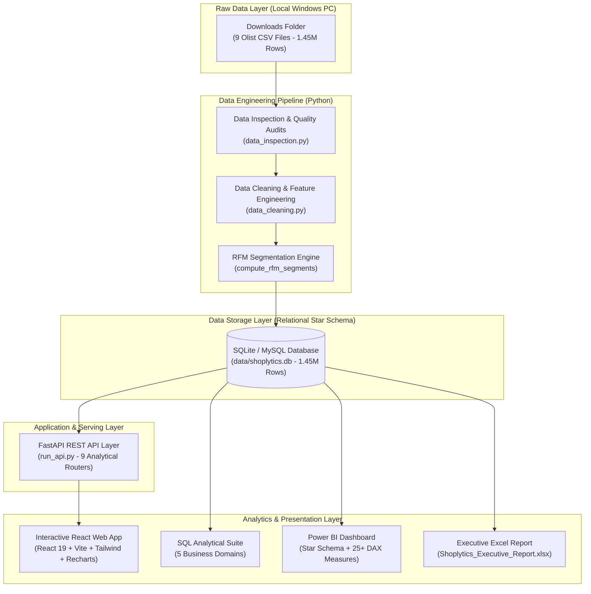
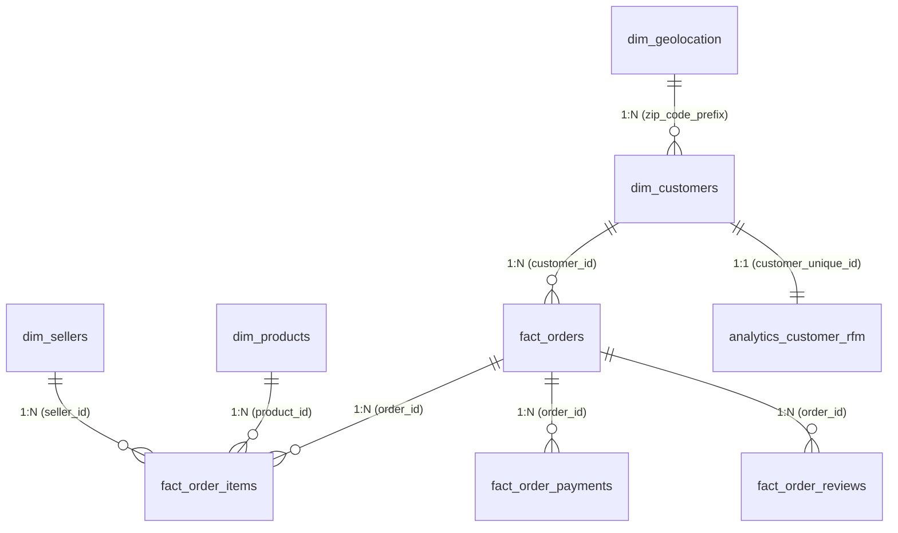

# Shoplytics — E-Commerce Sales & Customer Analytics Platform

[](https://www.python.org/)
[](https://fastapi.tiangolo.com/)
[](https://react.dev/)
[](https://tailwindcss.com/)
[](https://www.sqlite.org/)
[](https://powerbi.microsoft.com/)
[](https://docs.pytest.org/)
[](LICENSE)

**Shoplytics** is an end-to-end, enterprise-grade e-commerce sales and customer analytics web application engineered using **React 19**, **Vite**, **Tailwind CSS v4**, **FastAPI**, **SQLite**, and **Python**. It transforms over 1.45 million raw records from the **Brazilian Olist E-Commerce Dataset** into high-impact interactive business intelligence, featuring live KPI cards, RFM segmentation, cohort retention heatmaps, carrier SLA diagnostics, and automated quality audits.

---

## 📑 Table of Contents
- [1. Executive Summary & Key Business Findings](#1-executive-summary--key-business-findings)
- [2. Interactive Web Application](#2-interactive-web-application)
- [3. Platform Architecture](#3-platform-architecture)
- [4. Database Star Schema](#4-database-star-schema)
- [5. Dataset Overview](#5-dataset-overview)
- [6. Repository Structure](#6-repository-structure)
- [7. Installation & Quickstart Guide](#7-installation--quickstart-guide)
- [8. Analytical Domains & SQL Suite](#8-analytical-domains--sql-suite)
- [9. High-Performance REST API](#9-high-performance-rest-api)
- [10. Power BI Dashboard & DAX Measures](#10-power-bi-dashboard--dax-measures)
- [11. Executive Excel Report](#11-executive-excel-report)
- [12. Automated Testing & Reconciliation](#12-automated-testing--reconciliation)


---

## 1. Executive Summary & Key Business Findings

Empirical diagnostics computed across 96,478 delivered customer transactions revealed crucial business drivers:

| Metric Category | Actual Value | Strategic Insight |
| :--- | :--- | :--- |
| **Gross Merchandise Value (GMV)** | **R$ 15,419,778.47** | Total transaction volume (R$ 13.22M item merchandise + R$ 2.20M freight). |
| **Average Order Value (AOV)** | **R$ 137.04** | Healthy transaction size across 96,478 unique order transactions. |
| **Freight-to-Price Burden** | **16.63%** | Shipping costs represent ~1/6th of product value, increasing to **22%+ on bulky goods**. |
| **Payment Preferences** | **78.34% Credit Card** | Consumers heavily rely on credit installments (average 3.5 installments; max 24). |
| **On-Time Delivery Rate** | **91.89%** | Average actual delivery lead time is **12.6 days** vs **23.7 days** estimated SLA. |
| **Delivery Delay vs CSAT Crash** | **4.29 ★ vs 2.57 ★** | On-time orders average **4.29 stars** (6.6% 1-star). **When delivery is delayed, 1-star reviews surge to 46.16%** and average rating collapses to **2.57 stars**. |
| **Customer Loyalty & Repeat Rate** | **3.1% Repeat Rate** | **96.9% of buyers purchased only once**. Converting an additional 3-5% of one-time buyers into repeat customers represents a R$ 660,000+ incremental margin opportunity. |

---

## 2. Interactive Web Application

Shoplytics features a high-performance, responsive React 19 analytics dashboard built with Vite, Tailwind CSS v4, and Recharts. All metrics stream live from the FastAPI backend and SQLite star schema, supporting global state and category filtering:

### 🌟 7 Core Analytical Views
1. **Executive Overview (`/`)**:
   - Executive scorecards: GMV (R$ 15.42M), Orders (96,478), AOV (R$ 137.04), Repeat Rate (3.10%), On-Time SLA (91.89%), and CSAT (4.15 ★).
   - Monthly GMV revenue trend line chart with responsive tooltips.
   - Top 5 product categories horizontal bar chart and Payment methods donut chart.
   - Strategic Business Insights cards highlighting key findings and revenue opportunities.
2. **Sales Performance (`/sales`)**:
   - Monthly and daily transaction volume and revenue time-series.
   - Month-over-Month (MoM) revenue growth velocity bars.
   - Order fulfillment status distribution and payment tender installment breakdowns.
   - 2017 vs 2018 Year-over-Year comparison metrics table.
3. **Product Analytics (`/products`)**:
   - Top 10 revenue-generating product categories.
   - Pareto Analysis (80/20 rule) curve identifying high-impact inventory.
   - Weight tiers vs freight cost burden analysis (demonstrating freight drag on bulky items).
   - Searchable, sortable, and paginated 32,951-SKU catalog data table with CSV export.
4. **Customer Insights (`/customers`)**:
   - RFM Quintile Segmentation analysis (Champions, Loyal Customers, Potential Loyalists, At Risk, Lost).
   - One-time buyers vs repeat customer loyalty cohort breakdown.
   - Monthly Cohort Retention Heatmap matrix (tracking M+0 through M+8 retention decay).
   - Review patterns and score distributions across customer tiers.
5. **Delivery & Logistics (`/delivery`)**:
   - Carrier SLA fulfillment monitor (91.89% on-time vs 8.11% delay rate).
   - CSAT rating crash breakdown: **4.29 ★ on-time** vs **2.57 ★ delayed** (1-star reviews surge from 6.6% to 46.16%).
   - Delivery lead time elasticity curve (CSAT decay per transit day).
   - *Statistical Disclaimer*: Explicit statement that logistical correlation does not imply singular causation.
6. **Geographic Distribution (`/geo`)**:
   - Top revenue states (SP, RJ, MG, RS, PR) and 5 Macro-Region market shares (Southeast, South, Northeast, Central-West, North).
   - Regional transit lead time and freight disparity analysis.
   - Interactive 27-state performance ranking table with one-click CSV export.
7. **Data Quality & Audits (`/data-quality`)**:
   - Live database row counts across all 9 star schema tables.
   - Automated 0-duplicate primary key audit.
   - 4 Foreign key referential integrity validation tests (100% integrity).
   - Null-value profile and interactive Mermaid data lineage diagram.

---

## 3. Platform Architecture



---

## 4. Database Star Schema

The platform implements a Kimball-style Star Schema with referential integrity constraints, primary keys, and query-accelerating indexes:



- **`dim_customers`**: Unique customer profiles, cities, states, and postal codes (99,441 records).
- **`dim_products`**: Product catalog enriched with English category translations, formatted names, and physical cubic volume (32,951 products).
- **`dim_sellers`**: Merchant profiles and geographic locations (3,095 sellers).
- **`dim_geolocation`**: De-duplicated postal prefix coordinates with mean latitude/longitude (19,011 unique prefixes).
- **`fact_orders`**: Order lifecycle records with calculated actual lead times, estimated delivery durations, delay gaps, and delay flags (99,441 orders).
- **`fact_order_items`**: Line-item level details, prices, and freight values (112,650 items).
- **`fact_order_payments`**: Payment tenders, payment types, installments, and transaction values (103,886 payments).
- **`fact_order_reviews`**: Customer review scores, sentiment classes, and seller response times (99,224 reviews).
- **`analytics_customer_rfm`**: Recency, Frequency, Monetary (RFM) customer tiering (93,358 unique customers).

---

## 5. Dataset Overview

The project connects directly to the genuine **Olist Brazilian E-Commerce Dataset** stored locally without duplicating raw files:

| File Name | Size | Records | Description |
| :--- | :--- | :--- | :--- |
| `olist_customers_dataset.csv` | 8.62 MB | 99,441 | Customer demographic and location mappings |
| `olist_geolocation_dataset.csv` | 58.44 MB | 1,000,163 | Brazilian zip codes with geographic coordinates |
| `olist_order_items_dataset.csv` | 14.72 MB | 112,650 | Itemized product sales, prices, and freight charges |
| `olist_order_payments_dataset.csv` | 5.51 MB | 103,886 | Tender types, installment plans, and transaction amounts |
| `olist_order_reviews_dataset.csv` | 13.78 MB | 99,224 | Customer review scores (1-5) and feedback messages |
| `olist_orders_dataset.csv` | 16.84 MB | 99,441 | Order timestamps (purchase, approved, dispatched, delivered) |
| `olist_products_dataset.csv` | 2.27 MB | 32,951 | Product dimensions, categories, and photo counts |
| `olist_sellers_dataset.csv` | 0.17 MB | 3,095 | Seller locations and unique identifier registry |
| `product_category_name_translation.csv` | 2.5 KB | 71 | Portuguese to English category translation dictionary |

---

## 6. Repository Structure

```
Shoplytics-/
├── .env.example                     # Environment configuration template
├── .gitignore                        # Comprehensive exclusions (credentials, raw data, db)
├── requirements.txt                  # Python dependencies
├── run_pipeline.py                   # Master end-to-end data pipeline orchestrator
├── run_api.py                        # Uvicorn launcher for FastAPI REST server
├── README.md                         # Project documentation
│
├── frontend/                         # Interactive React 19 + Vite + Tailwind CSS Analytics Dashboard
│   ├── package.json                  # Frontend dependencies & scripts (Vite, Recharts, Lucide)
│   ├── vite.config.js                # Vite build configuration
│   └── src/
│       ├── api/                      # Axios API client & backend service abstractions
│       ├── components/               # Reusable UI components (KPICard, ChartCard, DataTable, etc.)
│       ├── context/                  # Global FilterContext provider (Date, State, Category filters)
│       ├── pages/                    # 7 Analytical Pages (Executive, Sales, Products, Customers, etc.)
│       └── utils/                    # Brazilian Real (BRL) currency & percentage formatters
│
├── src/
│   ├── __init__.py                   # Package initializer
│   ├── config.py                     # Environment loader & configuration paths
│   ├── data_inspection.py            # Non-destructive data quality & referential integrity auditor
│   ├── data_cleaning.py              # Cleaning, translations, SLA metrics, and RFM calculations
│   ├── database_loader.py            # Chunked database loader (MySQL + SQLite dual-engine)
│   ├── run_sql_queries.py            # Automated SQL query execution & markdown compiler
│   ├── excel_report_generator.py     # Multi-tab styled executive Excel workbook generator
│   └── api/                          # FastAPI REST API Backend
│       ├── main.py                   # Application initialization & CORS configuration
│       ├── database.py               # Database engine, connection pooling & dynamic filter helpers
│       ├── schemas.py                # Pydantic v2 data models & validation schemas
│       └── routers/                  # 8 domain routers (health, sales, logistics, customers, etc.)
│
├── sql/
│   ├── schema.sql                    # Production MySQL Star Schema DDL
│   └── queries/
│       ├── 01_sales_performance.sql  # Sales KPIs, monthly trends, MoM growth, payments
│       ├── 02_product_analytics.sql  # Best sellers, category Pareto, freight vs weight tiers
│       ├── 03_customer_segmentation.sql # RFM segments, repeat buyers, state penetration
│       ├── 04_delivery_logistics.sql # SLA on-time rate, state transit times, route efficiency
│       └── 05_customer_reviews.sql   # Review distribution, delay vs rating correlation
│
├── power_bi/
│   ├── README.md                     # Power BI module guide
│   ├── data_model_guide.md           # Star Schema blueprint, cardinalities, DAX calendar
│   ├── DAX_Measures.md               # 25+ production-grade DAX measures library
│   └── dashboard_wireframes.md       # Visual grid specifications for 4-page dashboard
│
├── notebooks/
│   └── shoplytics_eda.ipynb          # Comprehensive exploratory data analysis notebook
│
├── reports/
│   ├── Shoplytics_Executive_Report.xlsx # Formatted executive workbook with KPI cards
│   ├── data_quality_report.md        # Data hygiene and integrity check results
│   ├── data_quality_report.json      # Structured null and schema audit
│   ├── sql_query_insights.md         # Full output tables of all analytical SQL queries
│   └── sql_query_insights.json       # Raw query results dataset
│
├── data/
│   └── processed/                    # Cleaned analytical tables (.csv)
│       └── .gitkeep
│
└── tests/
    ├── __init__.py
    ├── test_api.py                   # 27 REST API integration tests across all endpoints
    ├── test_data_quality.py          # Unit tests: schema, PK uniqueness, delay flags, ranges
    └── test_reconciliation.py        # Financial and referential integrity reconciliation
```

---

## 7. Installation & Quickstart Guide

### 7.1 Prerequisites
- **Python 3.10+** installed
- **Node.js 18+** & **npm** installed (for the React analytics frontend)
- **Database**: SQLite (default zero-config engine) or **MySQL Server 8.0+**
- **Power BI Desktop** (for `.pbix` visual dashboards)
- **Microsoft Excel** (for `.xlsx` executive reports)

### 7.2 Clone Repository & Backend Setup
```bash
# 1. Clone the repository
git clone https://github.com/Anusha-2005/Shoplytics-.git
cd Shoplytics-

# 2. Create and activate Python virtual environment
python -m venv venv
# Windows PowerShell:
.\venv\Scripts\activate
# Linux/macOS:
source venv/bin/activate

# 3. Install Python backend dependencies
pip install -r requirements.txt
```

### 7.3 Configure Local Environment (`.env`)
Copy `.env.example` to `.env` and specify the location of your raw Olist CSV files:
```bash
cp .env.example .env
```
Edit `.env`:
```ini
# Path to your local directory containing the 9 genuine Olist CSV files
DATASET_DIR=C:/Users/anura/Downloads

# Database Engine Selection ('sqlite' or 'mysql')
DB_ENGINE=sqlite

# MySQL Settings (only if DB_ENGINE=mysql)
DB_HOST=localhost
DB_PORT=3306
DB_NAME=shoplytics
DB_USER=root
DB_PASSWORD=
```

### 7.4 Frontend Setup
```bash
cd frontend
npm install
cd ..
```

---

### 7.5 Executing the Data Engineering Pipeline

#### Option A: One-Click Master Pipeline
To execute the entire end-to-end data pipeline from hygiene audit to database loading, SQL analytics, Excel generation, and automated testing:
```bash
python run_pipeline.py
```

#### Option B: Step-by-Step Execution
```bash
# Step 1: Audit raw dataset hygiene and referential integrity
python src/data_inspection.py

# Step 2: Clean datasets, compute lead times, and perform RFM segmentation
python src/data_cleaning.py

# Step 3: Ingest star schema tables into SQLite / MySQL
python src/database_loader.py

# Step 4: Execute SQL analytics suite across all 5 business domains
python src/run_sql_queries.py

# Step 5: Generate styled multi-tab executive Excel workbook
python src/excel_report_generator.py

# Step 6: Run full automated test suite (38 tests)
pytest tests/ -v
```

---

### 7.6 Launching the Full-Stack Analytics Platform

Run both the FastAPI backend and React frontend concurrently:

#### Terminal 1 — Start the REST API Backend:
```bash
python run_api.py --reload
# Backend is live at: http://127.0.0.1:8000
# Interactive Swagger UI: http://127.0.0.1:8000/docs
```

#### Terminal 2 — Start the React Web Dashboard:
```bash
cd frontend
npm run dev
# Dashboard is live at: http://localhost:5173
```

---

## 8. Analytical Domains & SQL Suite

The SQL suite in `sql/queries/` covers 5 critical business domains:
1. **[01_sales_performance.sql](file:///sql/queries/01_sales_performance.sql)**:
   - High-level sales KPIs: Total revenue, AOV, GMV, freight ratio.
   - Monthly sales trajectory and MoM revenue growth rate.
   - Payment method share and installment adoption.
   - Peak sales days and hourly velocity.
2. **[02_product_analytics.sql](file:///sql/queries/02_product_analytics.sql)**:
   - Top 15 product categories by revenue and unit volume.
   - Pareto analysis: 80/20 revenue concentration curve.
   - Physical weight & volume tiers vs freight cost burden.
3. **[03_customer_segmentation.sql](file:///sql/queries/03_customer_segmentation.sql)**:
   - Customer RFM segment breakdown (Champions, Promising, At Risk, Lost).
   - One-time buyers vs repeat customer loyalty cohorts.
   - State-level customer penetration and spend.
4. **[04_delivery_logistics.sql](file:///sql/queries/04_delivery_logistics.sql)**:
   - Platform-wide on-time delivery rate vs delay rate.
   - State-by-state delivery lead times and SLA breaches.
   - Intra-state vs Inter-state shipping performance comparison.
5. **[05_customer_reviews.sql](file:///sql/queries/05_customer_reviews.sql)**:
   - Review score distribution (1 to 5 stars).
   - Root cause analysis: On-time delivery (4.29 ★) vs delayed delivery (2.57 ★).
   - Lowest-rated and highest-rated product categories.

---

## 9. High-Performance REST API

The platform provides a production-grade **FastAPI** analytics server serving real-time KPIs, dynamic filtering, customer RFM lookups, and ad-hoc analytical queries over 1.45M transactions.

### 9.1 Launching the API
```bash
# Start server with auto-reload (default: http://127.0.0.1:8000)
python run_api.py --reload

# Or directly with Uvicorn:
uvicorn src.api.main:app --host 127.0.0.1 --port 8000 --reload
```

Interactive Documentation:
- **Swagger UI**: [http://127.0.0.1:8000/docs](http://127.0.0.1:8000/docs)
- **ReDoc**: [http://127.0.0.1:8000/redoc](http://127.0.0.1:8000/redoc)

### 9.2 Endpoint Catalog

| HTTP Method | Route | Description |
| :--- | :--- | :--- |
| `GET` | `/api/v1/health` | Database connectivity, engine type, and table row counts across star schema. |
| `GET` | `/api/v1/health/quality-audit` | Complete data hygiene audit: 0-duplicate PKs and foreign key integrity. |
| `GET` | `/api/v1/analytics/kpi-summary` | Unified executive scorecard (GMV, AOV, On-Time %, CSAT, Repeat %). |
| `GET` | `/api/v1/analytics/filter-options` | Dynamic categories, states, date bounds, and fulfillment statuses. |
| `POST` | `/api/v1/analytics/query` | Read-only SQL query runner with security guards against DDL/DML. |
| `GET` | `/api/v1/sales/overview` | Macro sales numbers, merchandise revenue, freight margins, AOV. |
| `GET` | `/api/v1/sales/monthly-trends` | Longitudinal monthly revenue, orders, and MoM growth %. |
| `GET` | `/api/v1/sales/daily-trends` | Recent 30-day transactional velocity and rolling metrics. |
| `GET` | `/api/v1/sales/status-breakdown` | Order volume distribution across fulfillment states. |
| `GET` | `/api/v1/sales/payment-methods` | Credit card, boleto, voucher, debit breakdown and installment stats. |
| `GET` | `/api/v1/sales/hourly-patterns` | Peak sales revenue by day of week and hour of day. |
| `GET` | `/api/v1/logistics/overview` | SLA on-time rate (91.89%), average lead time (12.6 days), delay duration. |
| `GET` | `/api/v1/logistics/state-performance` | Delivery lead times and delay rates aggregated by destination state. |
| `GET` | `/api/v1/logistics/regional-performance` | Transit metrics consolidated across Brazil's 5 macro-regions. |
| `GET` | `/api/v1/logistics/route-comparison` | Intra-state vs Inter-state shipping comparison. |
| `GET` | `/api/v1/customers/rfm-summary` | Customer counts and GMV across 5 RFM behavioral clusters. |
| `GET` | `/api/v1/customers/repeat-behavior` | Retention cohorts (1-time buyers vs repeat and VIP customers). |
| `GET` | `/api/v1/customers/cohorts` | Monthly cohort retention matrix tracking M+0 through M+8 decay. |
| `GET` | `/api/v1/customers/state-distribution` | Unique buyers and revenue distribution by customer state. |
| `GET` | `/api/v1/customers/segment/{segment_name}` | Paginated customer profiles within an RFM cluster (limit & offset). |
| `GET` | `/api/v1/customers/lookup/{customer_id}` | Granular customer profile with RFM scores and historical orders. |
| `GET` | `/api/v1/products/top-categories` | Best-selling categories by revenue, units sold, and market share. |
| `GET` | `/api/v1/products/pareto-analysis` | 80/20 cumulative revenue concentration curve. |
| `GET` | `/api/v1/products/weight-tiers` | Weight classes vs freight cost burden. |
| `GET` | `/api/v1/products/table` | Paginated, searchable, and sortable 32,951-SKU catalog table. |
| `GET` | `/api/v1/reviews/overview` | Rating score distribution (1 to 5 stars) and seller response times. |
| `GET` | `/api/v1/reviews/delay-impact` | Delivery delay root cause: On-time (4.29 ★) vs Delayed (2.57 ★). |
| `GET` | `/api/v1/reviews/score-vs-leadtime` | CSAT rating elasticity across transit duration lead time tiers. |
| `GET` | `/api/v1/geo/summary` | Consolidated state and regional revenue, orders, and delivery metrics. |

---

## 10. Power BI Dashboard & DAX Measures

The Power BI module includes complete architecture blueprints:
- **[data_model_guide.md](file:///power_bi/data_model_guide.md)**: Star Schema data model layout, 1-to-many relationship mappings, cross-filter configurations, and continuous calendar table (`dim_date`).
- **[DAX_Measures.md](file:///power_bi/DAX_Measures.md)**: 25+ production-grade DAX measures with exact formulas:
  - *Financials*: `Total GMV`, `Total Merchandise Revenue`, `Total Orders`, `AOV`, `MoM Revenue Growth %`, `YTD Revenue`.
  - *Logistics*: `On-Time Delivery Rate %`, `Avg Delivery Lead Time Days`, `Avg Delay Days When Late`.
  - *Customers*: `Repeat Customer Rate %`, `Average Customer LTV`, `Unique Customers`.
  - *CSAT*: `Average Review Score`, `Positive Reviews %`, `Negative Reviews %`, `NPS Proxy Score`.
- **[dashboard_wireframes.md](file:///power_bi/dashboard_wireframes.md)**: Layout specifications for 4 report pages:
  - **Page 1**: Executive Sales Overview & Financial Performance
  - **Page 2**: Logistics & Delivery SLA Monitor
  - **Page 3**: Customer Intelligence & RFM Segments
  - **Page 4**: Product Category & Review Diagnostics

---

## 11. Executive Excel Report

Generated via `python src/excel_report_generator.py` into `reports/Shoplytics_Executive_Report.xlsx`:
- **Executive Summary**: KPI card tiles with Navy & Ice Blue theme (Total GMV, Merchandise Revenue, Delivered Orders, AOV, On-Time %, CSAT).
- **Monthly Sales**: Month-by-month table with revenue, orders, AOV, freight %, and conditional MoM growth flags.
- **Top Product Categories**: Top 20 categories sorted by revenue with unit volumes and market share.
- **Customer RFM Segments**: RFM tier breakdown with total spend and average recency.
- **Strategic Recommendations**: 5 prioritized initiatives with data evidence, action plans, and financial impact projections.

---

## 12. Automated Testing & Reconciliation

The platform maintains a comprehensive test suite of **38 automated tests** passing with Pytest:
```bash
pytest -v
```

**Test Coverage Categories**:
1. **Data Quality Tests (`tests/test_data_quality.py`)** (5 tests):
   - `test_raw_dataset_files_exist`: Confirms all 9 raw files are present in the downloads directory.
   - `test_processed_tables_exist`: Confirms all clean analytical CSV tables exist in `data/processed/`.
   - `test_primary_key_uniqueness`: Audits zero primary key duplicates across dimensions and facts.
   - `test_delivery_delay_flag_logic`: Validates boolean accuracy of `is_delayed` calculation.
   - `test_review_score_domain`: Confirms all customer review scores fall strictly in the `[1, 5]` range.

2. **Referential Integrity & Reconciliation (`tests/test_reconciliation.py`)** (6 tests):
   - `test_referential_integrity_*`: Verifies zero orphaned foreign keys between orders, items, products, sellers, and customers.
   - `test_financial_reconciliation_items_vs_payments`: Reconciles item GMV against payments within tight operational tolerance.
   - `test_order_customer_cardinality`: Enforces 1-to-1 order-to-customer cardinality.

3. **REST API Integration Tests (`tests/test_api.py`)** (27 tests):
   - 27 comprehensive tests verifying status codes, JSON schema models, pagination, dynamic filtering, security guards against malicious SQL, and data accuracy across all 9 analytical routers.

---

## 13. License
This project is licensed under the MIT License — see the [LICENSE](LICENSE) file for details.

