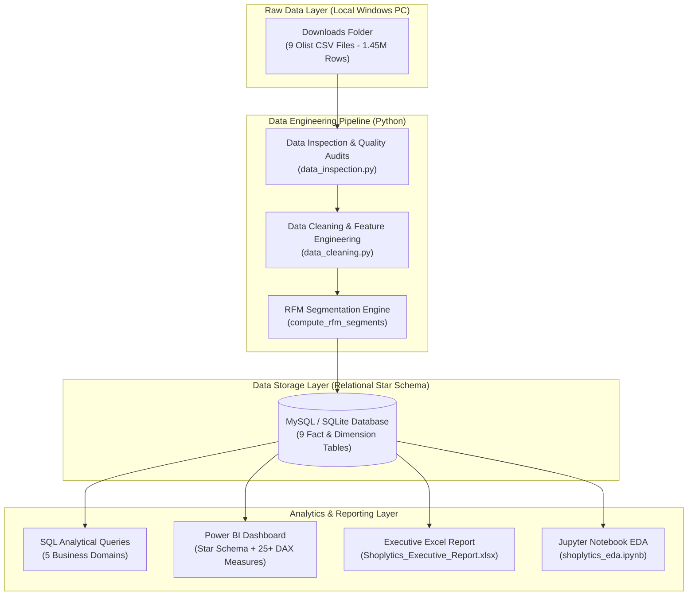
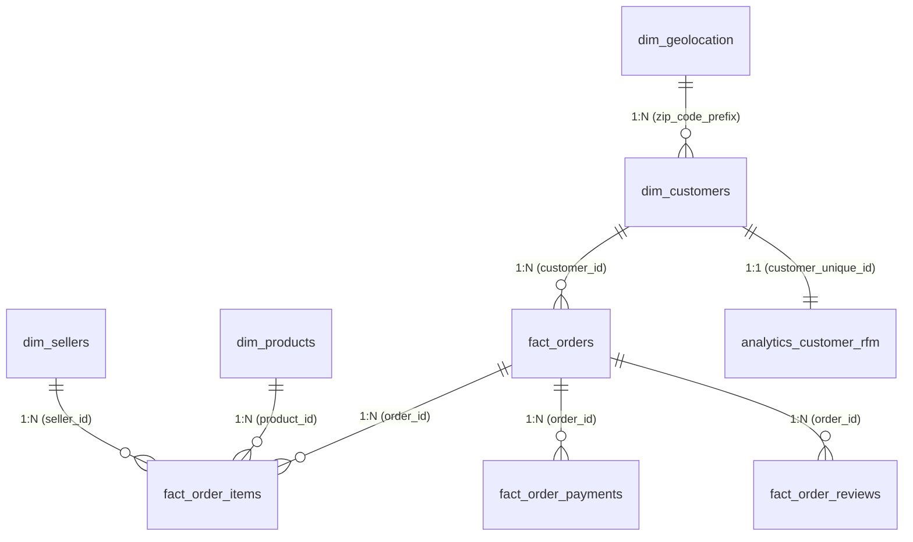

# Shoplytics — E-Commerce Sales & Customer Analytics Platform

[](https://www.python.org/)
[](https://www.mysql.com/)
[](https://powerbi.microsoft.com/)
[](https://docs.pytest.org/)
[](LICENSE)

**Shoplytics** is an end-to-end e-commerce sales and customer analytics platform engineered using Python, Pandas, MySQL/SQL, Jupyter, Power BI, and Excel. It transforms over 1.45 million raw records from the **Olist Brazilian E-Commerce Dataset** into high-value business intelligence, automated KPI reporting, customer RFM segmentation, and root-cause logistics diagnostics.

---

## 📑 Table of Contents
- [1. Executive Summary & Key Business Findings](#1-executive-summary--key-business-findings)
- [2. Platform Architecture](#2-platform-architecture)
- [3. Database Star Schema](#3-database-star-schema)
- [4. Dataset Overview](#4-dataset-overview)
- [5. Repository Structure](#5-repository-structure)
- [6. Installation & Environment Setup](#6-installation--environment-setup)
- [7. Execution Guide](#7-execution-guide)
- [8. Analytical Domains & SQL Suite](#8-analytical-domains--sql-suite)
- [9. Power BI Dashboard & DAX Measures](#9-power-bi-dashboard--dax-measures)
- [10. Executive Excel Report](#10-executive-excel-report)
- [11. Automated Testing & Reconciliation](#11-automated-testing--reconciliation)

---

## 1. Executive Summary & Key Business Findings

Empirical diagnostics computed across 96,478 delivered customer transactions revealed crucial business drivers:

| Metric Category | Actual Value | Strategic Insight |
| :--- | :--- | :--- |
| **Gross Merchandise Value (GMV)** | **R$ 15,419,778.47** | Total transaction volume (R$ 13.22M item merchandise + R$ 2.20M freight). |
| **Average Order Value (AOV)** | **R$ 137.04** | Healthy transaction size across 96,478 unique order transactions. |
| **Freight-to-Price Burden** | **16.63%** | Shipping costs represent ~1/6th of product value, increasing to **22%+ on bulky goods**. |
| **Payment Preferences** | **78.34% Credit Card** | Consumers heavily rely on credit installments (average 3.5 installments; max 24). |
| **On-Time Delivery Rate** | **91.89%** | Average actual delivery lead time is **12.6 days** vs **23.7 days** estimated SLA. |
| **Delivery Delay vs CSAT Crash** | **4.29 ★ vs 2.57 ★** | On-time orders average **4.29 stars** (6.6% 1-star). **When delivery is delayed, 1-star reviews surge to 46.16%** and average rating collapses to **2.57 stars**. |
| **Customer Loyalty & Repeat Rate** | **3.1% Repeat Rate** | **96.9% of buyers purchased only once**. Converting an additional 3-5% of one-time buyers into repeat customers represents a R$ 660,000+ incremental margin opportunity. |

---

## 2. Platform Architecture



---

## 3. Database Star Schema

The platform implements a Kimball-style Star Schema with referential integrity constraints, primary keys, and query-accelerating indexes:



- **`dim_customers`**: Unique customer profiles, cities, states, and postal codes (99,441 records).
- **`dim_products`**: Product catalog enriched with English category translations, formatted names, and physical cubic volume (32,951 products).
- **`dim_sellers`**: Merchant profiles and geographic locations (3,095 sellers).
- **`dim_geolocation`**: De-duplicated postal prefix coordinates with mean latitude/longitude (19,011 unique prefixes).
- **`fact_orders`**: Order lifecycle records with calculated actual lead times, estimated delivery durations, delay gaps, and delay flags (99,441 orders).
- **`fact_order_items`**: Line-item level details, prices, and freight values (112,650 items).
- **`fact_order_payments`**: Payment tenders, payment types, installments, and transaction values (103,886 payments).
- **`fact_order_reviews`**: Customer review scores, sentiment classes, and seller response times (99,224 reviews).
- **`analytics_customer_rfm`**: Recency, Frequency, Monetary (RFM) customer tiering (93,358 unique customers).

---

## 4. Dataset Overview

The project connects directly to the genuine **Olist Brazilian E-Commerce Dataset** stored locally without duplicating raw files:

| File Name | Size | Records | Description |
| :--- | :--- | :--- | :--- |
| `olist_customers_dataset.csv` | 8.62 MB | 99,441 | Customer demographic and location mappings |
| `olist_geolocation_dataset.csv` | 58.44 MB | 1,000,163 | Brazilian zip codes with geographic coordinates |
| `olist_order_items_dataset.csv` | 14.72 MB | 112,650 | Itemized product sales, prices, and freight charges |
| `olist_order_payments_dataset.csv` | 5.51 MB | 103,886 | Tender types, installment plans, and transaction amounts |
| `olist_order_reviews_dataset.csv` | 13.78 MB | 99,224 | Customer review scores (1-5) and feedback messages |
| `olist_orders_dataset.csv` | 16.84 MB | 99,441 | Order timestamps (purchase, approved, dispatched, delivered) |
| `olist_products_dataset.csv` | 2.27 MB | 32,951 | Product dimensions, categories, and photo counts |
| `olist_sellers_dataset.csv` | 0.17 MB | 3,095 | Seller locations and unique identifier registry |
| `product_category_name_translation.csv` | 2.5 KB | 71 | Portuguese to English category translation dictionary |

---

## 5. Repository Structure

```
Shoplytics-/
├── .env.example                     # Environment configuration template
├── .gitignore                        # Comprehensive exclusions (credentials, raw data, db)
├── requirements.txt                  # Python dependencies
├── run_pipeline.py                   # Master end-to-end pipeline orchestrator
├── README.md                         # Project documentation
│
├── src/
│   ├── __init__.py                   # Package initializer
│   ├── config.py                     # Environment loader & configuration paths
│   ├── data_inspection.py            # Non-destructive data quality & referential integrity auditor
│   ├── data_cleaning.py              # Cleaning, translations, SLA metrics, and RFM calculations
│   ├── database_loader.py            # Chunked database loader (MySQL + SQLite dual-engine)
│   ├── run_sql_queries.py            # Automated SQL query execution & markdown compiler
│   └── excel_report_generator.py     # Multi-tab styled executive Excel workbook generator
│
├── sql/
│   ├── schema.sql                    # Production MySQL Star Schema DDL
│   └── queries/
│       ├── 01_sales_performance.sql  # Sales KPIs, monthly trends, MoM growth, payments
│       ├── 02_product_analytics.sql  # Best sellers, category Pareto, freight vs weight tiers
│       ├── 03_customer_segmentation.sql # RFM segments, repeat buyers, state penetration
│       ├── 04_delivery_logistics.sql # SLA on-time rate, state transit times, route efficiency
│       └── 05_customer_reviews.sql   # Review distribution, delay vs rating correlation
│
├── power_bi/
│   ├── README.md                     # Power BI module guide
│   ├── data_model_guide.md           # Star Schema blueprint, cardinalities, DAX calendar
│   ├── DAX_Measures.md               # 25+ production-grade DAX measures library
│   └── dashboard_wireframes.md       # Visual grid specifications for 4-page dashboard
│
├── notebooks/
│   └── shoplytics_eda.ipynb          # Comprehensive exploratory data analysis notebook
│
├── reports/
│   ├── Shoplytics_Executive_Report.xlsx # Formatted executive workbook with KPI cards
│   ├── data_quality_report.md        # Data hygiene and integrity check results
│   ├── data_quality_report.json      # Structured null and schema audit
│   ├── sql_query_insights.md         # Full output tables of all analytical SQL queries
│   └── sql_query_insights.json       # Raw query results dataset
│
├── data/
│   └── processed/                    # Cleaned analytical tables (.csv)
│       └── .gitkeep
│
└── tests/
    ├── __init__.py
    ├── test_data_quality.py          # Unit tests: schema, PK uniqueness, delay flags, ranges
    └── test_reconciliation.py        # Financial and referential integrity reconciliation
```

---

## 6. Installation & Environment Setup

### 6.1 Prerequisites
- Python 3.10+ installed
- MySQL Server (Optional — the platform automatically falls back to SQLite if MySQL is offline)
- Power BI Desktop (for visual dashboard consumption)
- Microsoft Excel (for executive workbook viewing)

### 6.2 Clone Repository & Install Dependencies
```bash
# Clone the repository
git clone https://github.com/Anusha-2005/Shoplytics-.git
cd Shoplytics-

# Create and activate virtual environment (optional but recommended)
python -m venv venv
# Windows:
.\venv\Scripts\activate
# Linux/Mac:
source venv/bin/activate

# Install dependencies
pip install -r requirements.txt
```

### 6.3 Configure Local Environment (`.env`)
Copy `.env.example` to `.env` and set the path to where your Olist dataset is located:
```bash
cp .env.example .env
```
Edit `.env`:
```ini
# Path to your local Downloads folder containing the 9 Olist CSV files
DATASET_DIR=C:/Users/anura/Downloads

# Database Engine Selection ('sqlite' or 'mysql')
DB_ENGINE=sqlite

# MySQL Settings (if DB_ENGINE=mysql)
DB_HOST=localhost
DB_PORT=3306
DB_NAME=shoplytics
DB_USER=root
DB_PASSWORD=
```

---

## 7. Execution Guide

### Option 1: One-Click Master Pipeline
To run the entire pipeline from inspection to testing in one command:
```bash
python run_pipeline.py
```

### Option 2: Run Step-by-Step

#### Step 1: Inspect Dataset Hygiene
```bash
python src/data_inspection.py
```
*Outputs: `reports/data_quality_report.md` and `reports/data_quality_report.json`.*

#### Step 2: Clean & Transform Data
```bash
python src/data_cleaning.py
```
*Outputs: 9 cleaned tables and RFM segmentation in `data/processed/`.*

#### Step 3: Load Database (MySQL / SQLite)
```bash
python src/database_loader.py
```
*Ingests tables in relational order with analytical indexing.*

#### Step 4: Execute Analytical SQL Queries
```bash
python src/run_sql_queries.py
```
*Executes all queries in `sql/queries/` and compiles findings into `reports/sql_query_insights.md`.*

#### Step 5: Generate Executive Excel Workbook
```bash
python src/excel_report_generator.py
```
*Outputs formatted multi-tab report `reports/Shoplytics_Executive_Report.xlsx`.*

#### Step 6: Run Automated Tests
```bash
pytest tests/ -v
```

#### Step 7: Launch Exploratory Data Analysis
```bash
jupyter notebook notebooks/shoplytics_eda.ipynb
```

---

## 8. Analytical Domains & SQL Suite

The SQL suite in `sql/queries/` covers 5 critical business domains:
1. **[01_sales_performance.sql](file:///sql/queries/01_sales_performance.sql)**:
   - High-level sales KPIs: Total revenue, AOV, GMV, freight ratio.
   - Monthly sales trajectory and MoM revenue growth rate.
   - Payment method share and installment adoption.
   - Peak sales days and hourly velocity.
2. **[02_product_analytics.sql](file:///sql/queries/02_product_analytics.sql)**:
   - Top 15 product categories by revenue and unit volume.
   - Pareto analysis: 80/20 revenue concentration curve.
   - Physical weight & volume tiers vs freight cost burden.
3. **[03_customer_segmentation.sql](file:///sql/queries/03_customer_segmentation.sql)**:
   - Customer RFM segment breakdown (Champions, Promising, At Risk, Lost).
   - One-time buyers vs repeat customer loyalty cohorts.
   - State-level customer penetration and spend.
4. **[04_delivery_logistics.sql](file:///sql/queries/04_delivery_logistics.sql)**:
   - Platform-wide on-time delivery rate vs delay rate.
   - State-by-state delivery lead times and SLA breaches.
   - Intra-state vs Inter-state shipping performance comparison.
5. **[05_customer_reviews.sql](file:///sql/queries/05_customer_reviews.sql)**:
   - Review score distribution (1 to 5 stars).
   - Root cause analysis: On-time delivery (4.29 ★) vs delayed delivery (2.57 ★).
   - Lowest-rated and highest-rated product categories.

---

## 9. Power BI Dashboard & DAX Measures

The Power BI module includes complete architecture blueprints:
- **[data_model_guide.md](file:///power_bi/data_model_guide.md)**: Star Schema data model layout, 1-to-many relationship mappings, cross-filter configurations, and continuous calendar table (`dim_date`).
- **[DAX_Measures.md](file:///power_bi/DAX_Measures.md)**: 25+ production-grade DAX measures with exact formulas:
  - *Financials*: `Total GMV`, `Total Merchandise Revenue`, `Total Orders`, `AOV`, `MoM Revenue Growth %`, `YTD Revenue`.
  - *Logistics*: `On-Time Delivery Rate %`, `Avg Delivery Lead Time Days`, `Avg Delay Days When Late`.
  - *Customers*: `Repeat Customer Rate %`, `Average Customer LTV`, `Unique Customers`.
  - *CSAT*: `Average Review Score`, `Positive Reviews %`, `Negative Reviews %`, `NPS Proxy Score`.
- **[dashboard_wireframes.md](file:///power_bi/dashboard_wireframes.md)**: Layout specifications for 4 report pages:
  - **Page 1**: Executive Sales Overview & Financial Performance
  - **Page 2**: Logistics & Delivery SLA Monitor
  - **Page 3**: Customer Intelligence & RFM Segments
  - **Page 4**: Product Category & Review Diagnostics

---

## 10. Executive Excel Report

Generated via `python src/excel_report_generator.py` into `reports/Shoplytics_Executive_Report.xlsx`:
- **Executive Summary**: KPI card tiles with Navy & Ice Blue theme (Total GMV, Merchandise Revenue, Delivered Orders, AOV, On-Time %, CSAT).
- **Monthly Sales**: Month-by-month table with revenue, orders, AOV, freight %, and conditional MoM growth flags.
- **Top Product Categories**: Top 20 categories sorted by revenue with unit volumes and market share.
- **Customer RFM Segments**: RFM tier breakdown with total spend and average recency.
- **Strategic Recommendations**: 5 prioritized initiatives with data evidence, action plans, and financial impact projections.

---

## 11. Automated Testing & Reconciliation

All 11 unit and data reconciliation tests are automated using `pytest`:
```bash
pytest tests/ -v
```
**Test Coverage**:
- `test_raw_dataset_files_exist`: Confirms all 9 raw files are present in the configured downloads path.
- `test_processed_tables_exist`: Confirms all clean analytical tables exist in `data/processed/`.
- `test_primary_key_uniqueness`: Audits zero primary key duplicates on `orders`, `customers`, `products`, `sellers`, and `rfm`.
- `test_delivery_delay_flag_logic`: Verifies boolean accuracy of `is_delayed` against delivery and estimated dates.
- `test_review_score_domain`: Confirms all customer review scores fall strictly in the `[1, 5]` range.
- `test_referential_integrity_*`: Verifies zero orphaned foreign keys between orders, items, products, sellers, and customers.
- `test_financial_reconciliation_items_vs_payments`: Reconciles item GMV against payments within tight operational tolerance.
- `test_order_customer_cardinality`: Enforces 1-to-1 order-to-customer cardinality.

---

## 12. License
This project is licensed under the MIT License — see the [LICENSE](LICENSE) file for details.
