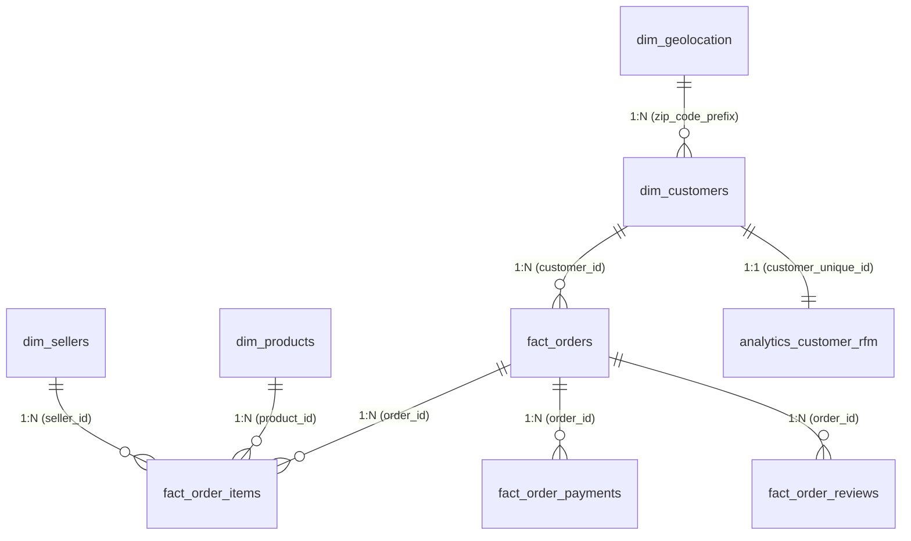

# Shoplytics — Power BI Data Modeling Architecture Guide

## 1. Relational Star Schema Overview
The Shoplytics analytical data model implements an optimized Kimball-style **Star Schema** designed for high query performance, clean visual filtering, and zero bidirectional ambiguity.



---

## 2. Table Cardinalities & Relationship Catalog

| From Table (Parent/Dim) | Key Column | To Table (Child/Fact) | Foreign Key Column | Cardinality | Cross Filter Direction | Security / Filter Behavior |
| :--- | :--- | :--- | :--- | :--- | :--- | :--- |
| `dim_customers` | `customer_id` | `fact_orders` | `customer_id` | 1 : Many (1:*) | Single (Dim -> Fact) | Standard |
| `dim_products` | `product_id` | `fact_order_items` | `product_id` | 1 : Many (1:*) | Single (Dim -> Fact) | Standard |
| `dim_sellers` | `seller_id` | `fact_order_items` | `seller_id` | 1 : Many (1:*) | Single (Dim -> Fact) | Standard |
| `fact_orders` | `order_id` | `fact_order_items` | `order_id` | 1 : Many (1:*) | Single (Orders -> Items) | Standard |
| `fact_orders` | `order_id` | `fact_order_payments` | `order_id` | 1 : Many (1:*) | Single (Orders -> Payments) | Standard |
| `fact_orders` | `order_id` | `fact_order_reviews` | `order_id` | 1 : Many (1:*) | Single (Orders -> Reviews) | Standard |
| `dim_customers` | `customer_unique_id`| `analytics_customer_rfm`| `customer_unique_id`| 1 : 1 | Both | RFM Filter Propagation |
| `dim_geolocation` | `zip_code_prefix`| `dim_customers` | `customer_zip_code_prefix` | 1 : Many (1:*) | Single (Geo -> Customers) | Aggregated unique zip |

---

## 3. Dedicated Calendar Dimension (`dim_date`)
In Power BI, create a dedicated continuous Date table using DAX to enable time intelligence functions (`TOTALYTD`, `DATEADD`, `SAMEPERIODLASTYEAR`):

```dax
dim_date = 
VAR MinDate = DATE(2016, 1, 1)
VAR MaxDate = DATE(2018, 12, 31)
RETURN
ADDCOLUMNS(
    CALENDAR(MinDate, MaxDate),
    "Year", YEAR([Date]),
    "Year-Month", FORMAT([Date], "YYYY-MM"),
    "Month Number", MONTH([Date]),
    "Month Name", FORMAT([Date], "MMMM"),
    "Month Short", FORMAT([Date], "MMM"),
    "Quarter", "Q" & FORMAT([Date], "Q"),
    "Year-Quarter", FORMAT([Date], "YYYY") & "-Q" & FORMAT([Date], "Q"),
    "Day of Week", FORMAT([Date], "dddd"),
    "Day Number", WEEKDAY([Date], 2),
    "Is Weekend", IF(WEEKDAY([Date], 2) IN {6, 7}, 1, 0)
)
```

Relationship:
- Connect `dim_date[Date]` (1) -> `fact_orders[order_purchase_timestamp]` (*) with Single filter direction.
- Mark `dim_date` as Date Table in Power BI Desktop.

---

## 4. How to Connect Power BI to the Processed Data
1. Open **Power BI Desktop**.
2. Select **Get Data** -> **Folder** or **CSV/Text** -> point to `Shoplytics-/data/processed/` (or choose **MySQL Database** / **ODBC** if connecting directly to MySQL server).
3. Import the clean tables:
   - `clean_orders.csv` -> Rename to `fact_orders`
   - `clean_order_items.csv` -> Rename to `fact_order_items`
   - `clean_order_payments.csv` -> Rename to `fact_order_payments`
   - `clean_order_reviews.csv` -> Rename to `fact_order_reviews`
   - `clean_products.csv` -> Rename to `dim_products`
   - `clean_customers.csv` -> Rename to `dim_customers`
   - `clean_sellers.csv` -> Rename to `dim_sellers`
   - `clean_geolocation.csv` -> Rename to `dim_geolocation`
   - `customer_rfm_segments.csv` -> Rename to `analytics_customer_rfm`
4. Set column data types (Datetimes, Decimals, Whole Numbers, Text) as listed in the schema.
5. Create relationships in Model View as detailed in Section 2.
6. Create a new measure table `_Measures` and paste all measures from `DAX_Measures.md`.
